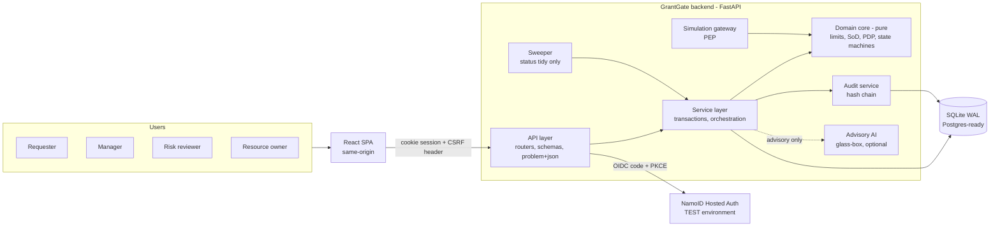
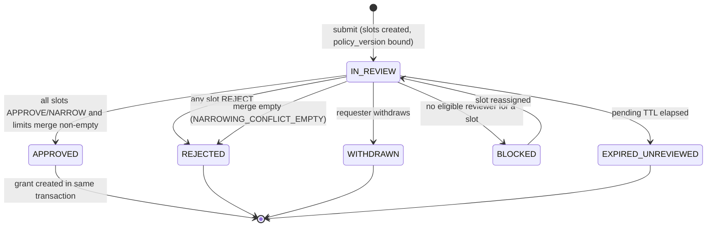
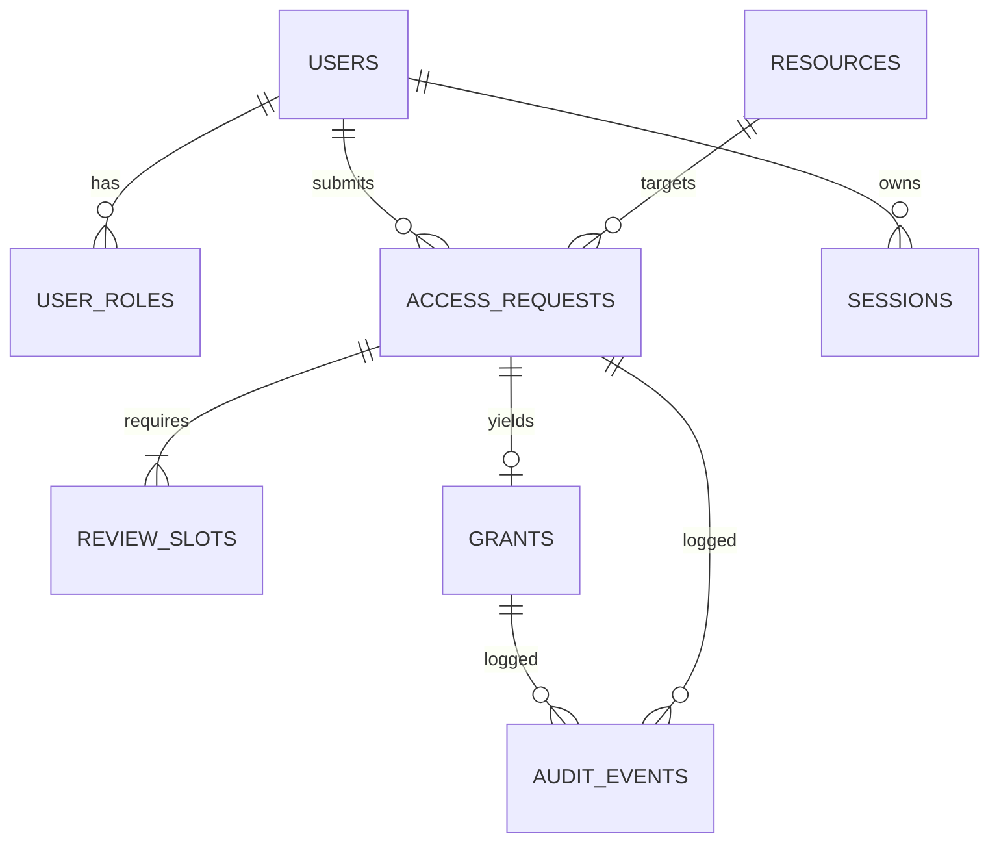

# GrantGate — Secure Model & Dataset Access Governance
### Engineering blueprint for the NamoID challenge (v1.0 — innovation module selection pending)

> **Status:** Core design is final. Section 14 contains the innovation menu; modules are marked `PENDING SELECTION` until chosen.
> **How to use this file:** Save as `docs/BLUEPRINT.md` in the repo. Every Antigravity prompt in §15 begins with "Read docs/BLUEPRINT.md §X", so the agent always works from this single source of truth. Do not paste the whole file into one prompt.

---

## 0. Reading map

| You want… | Go to |
|---|---|
| What the challenge and NamoID actually require | §2, §3 |
| Can we finish in six hours? What could go wrong? | §4 |
| The architecture, stack, data model, state machines | §5, §6 |
| Hosted Auth integration design | §7 |
| API contract | §8 |
| Every edge case with expected behaviour | §9 |
| Test strategy and the four mandatory tests | §10 |
| Security / privacy / safety posture | §11 |
| Frontend / backend / AI specs | §12, §13, §14 |
| **Copy-paste prompts for Antigravity** | **§15** |
| Hour-by-hour plan, submission checklist, "first real resource" | §16, §17 |
| Questions still open (with safe defaults) | §18 |

---

## 1. Executive summary

**GrantGate** is a role-based access-governance application. A person signs in through **NamoID Hosted Auth**, but signing in grants *nothing*. To use a mock AI model or dataset they must file a structured request (resource, purpose, actions, duration, risk controls). The required reviewers — **manager, risk reviewer, resource owner** — each **approve, narrow, or reject**. Only when every required review is complete does the system mint a **grant** bound to requester, resource, purpose, actions and an expiry. Every protected operation is then checked by a **deterministic Policy Decision Point (PDP)** that denies on expiry, revocation, wrong purpose, or out-of-scope action. Everything is recorded in a **tamper-evident, append-only audit log**.

### Design principles (non-negotiable)

1. **Enforcement lives in the backend, never in the UI.** Hidden buttons are cosmetics.
2. **Authentication ≠ authorization.** A valid session proves identity only; each protected call re-evaluates the grant.
3. **Functional core, imperative shell.** All decision logic (limits algebra, separation of duties, PDP, state machines) is pure functions with no I/O → exhaustively unit- and property-testable.
4. **Derived, not trusted, status.** "Is this grant usable *now*?" is computed from `revoked_at` and `expires_at` at check time. A background sweeper only tidies stored status; if it dies, access still ends on time.
5. **Immutability by construction.** Requests, decisions, grants' scope fields and audit events cannot be updated — enforced in code *and* by database triggers.
6. **Glass-box intelligence.** Any AI/analytics is advisory, deterministic where it matters, shows its factors, and can never grant, extend, or revoke on its own.
7. **Explain every decision.** Every allow/deny returns an ordered *decision trace* (which checks ran, which failed, why).
8. **Mock-only, minimal data.** No production AI, no sensitive data, no secrets in free text; and the UI never implies that approval makes use *safe*.

---

## 2. Source analysis

### 2.1 What the three sources say

| Source | Key content |
|---|---|
| **SRC-A: challenge screenshot** | Four roles authenticate via Hosted Auth. Request names a mock model/dataset, purpose, duration, risk controls. Reviewers approve / narrow / reject. Approved access activates and expires automatically. Show active grants + decision history. Prevent: self-approval, use outside approved-purpose simulation, silent extensions, access after revocation. **Safety:** mock models/datasets/credentials/outputs only; no production AI; no sensitive data; don't imply approval makes use safe. **Submission:** public repo, demo/recording, tests, sample access history; test separation of duties, expiry, narrowed scope, emergency revocation; **stop after six focused hours**; identify the first real resource this could govern. |
| **SRC-B: NamoID brief (docx)** | Detailed problem statement, 9 functional requirements (§4.1–4.9), 6 mandatory safeguards (§5), workflow (§6), company-aligned considerations (§7), scope/assumptions (§8), success criteria (§9). Key instruction: the required-reviewer rule must be **explicit and configurable**; risk-control fields, duration limits, retention and extension approvers are **not specified → configurable or confirm, don't invent as company policy**. |
| **SRC-C: public NamoID research** (PyPI SDK page, namoid.in docs references) | Python SDK `namoid` (v0.2.0 at time of research; PyPI classifier says **Pre-Alpha**). `NamoIDClient` / `AsyncNamoIDClient`: `create_oidc_transaction`, `authorization_url`, `exchange_code`, `validate_id_token` (JWKS, local verification, nonce), `user_info`, `refresh`, `revoke_token`, `logout_url`, `validate_access_token`. OIDC Authorization Code + **S256 PKCE**; discovery supplies endpoints. Confidential web apps authenticate to the token endpoint with the client secret (server-side only); public clients omit the secret. NamoID also ships MCP authorization helpers (`namoid.mcp`) where scopes mean "permission to *attempt*"; business rules stay in the handler. Dynamic Client Registration is unavailable for customer-owned MCP resources (pre-registration or CIMD only). |

### 2.2 Company preferences → design decisions

| # | NamoID preference (SRC-B §7 / SRC-C) | Design decision in GrantGate |
|---|---|---|
| CO-1 | Hosted Auth via OIDC code + PKCE S256 is the supported path | Backend-for-Frontend (BFF) flow using the official `namoid` SDK; no custom login, no tokens in the browser |
| CO-2 | Authentication and authorization are separate | Session = identity; PDP evaluates a grant on **every** protected call |
| CO-3 | Least-privilege, scoped, short-lived grants | Grants carry exact resource + action set + purpose + expiry; duration caps by resource tier |
| CO-4 | Revocation independent of login session | Sign-out never touches grants; revoking a grant never needs the user's session; separate tests prove both directions |
| CO-5 | Append-only audit; corrections are new events | Hash-chained event log + DB triggers; corrections only via compensating events |
| CO-6 | Data minimisation / DPDP-readiness (without claiming compliance) | Events store `sub` + role, not emails; secret/PII-pattern scanner on free text; README states "supports privacy work; does not by itself ensure legal compliance" |
| CO-7 | Test vs Live environment separation | `NAMOID_ENV=test` default; startup refuses to run if client id looks like a Live one while `DEMO_MODE=true`; credentials only via env |
| CO-8 | Some NamoID features are previews/early access | Identity code sits behind an `IdentityProvider` interface; SDK is pre-alpha → fallback adapter (plain OIDC with `authlib`/`httpx`) is ready; **confirm tenant features** (see §18) |
| CO-9 | Approval matrix explicit and configurable | `policy.yaml`, versioned, bound to each request at submission |
| CO-10 | MCP authorization is a NamoID direction | "First real resource" recommendation (§17.3) is an MCP-served read-only dataset, mapping grant actions → MCP scopes |

---

## 3. Requirements & traceability

IDs are used throughout (prompts, edge cases, tests).

### 3.1 Functional

| ID | Requirement | Source |
|---|---|---|
| FR-01 | All four roles sign in through NamoID Hosted Auth | A, B§4.1 |
| FR-02 | App identifies the user and their role(s); login ≠ permission | B§4.1 |
| FR-03 | Requester submits request: resource, purpose, duration, risk controls (+ actions). Stored with requester and timestamp | A, B§4.2 |
| FR-04 | System determines required reviewers and routes the request; pending / completed / rejected states are visible | B§4.3 |
| FR-05 | Reviewer decisions: Approve, Narrow (records exact approved limits), Reject | A, B§4.4 |
| FR-06 | Access activates only after **all** required approvals; grant tied to requester, resource, purpose, scope, expiry | B§4.5 |
| FR-07 | Grants expire automatically | A, B§4.6 |
| FR-08 | Active-grants view (who, what, purpose/scope, until when) | A, B§4.7 |
| FR-09 | Decision history (who, role, decision, narrowing, time) | A, B§4.8 |
| FR-10 | Authorized revocation makes a grant unusable immediately, overriding expiry | B§4.9 |

### 3.2 Safeguards (each has a dedicated test group, §10)

| ID | Safeguard |
|---|---|
| SG-1 | **No self-approval** — enforced in backend authorization |
| SG-2 | **No use outside approved purpose** — checked in the simulation gateway |
| SG-3 | **No silent extension** — extension only via explicit, recorded new request |
| SG-4 | **No access after revocation** — revocation overrides expiry, immediately |
| SG-5 | **No access before all approvals** — partial/pending never creates a grant |
| SG-6 | **No broader access after narrowing** — narrowed limits are what is enforced |

### 3.3 Submission & safety

| ID | Requirement |
|---|---|
| SUB-1 | Public repository |
| SUB-2 | Demo or recording |
| SUB-3 | Automated tests |
| SUB-4 | Sample access history (generated, deterministic, committed) |
| SUB-5 | Tests for separation of duties, expiry, narrowed scope, emergency revocation (named explicitly, §10.4) |
| SUB-6 | Time-box: stop after six focused hours |
| SUB-7 | Identify the first real resource this could govern (§17.3) |
| SAFE-1 | Mock models, datasets, credentials, outputs only |
| SAFE-2 | No connection to production AI systems |
| SAFE-3 | No sensitive data ingestion |
| SAFE-4 | UI/docs never imply approval makes use safe |

### 3.4 Non-functional targets

| ID | Target |
|---|---|
| NFR-1 | PDP check p95 < 50 ms locally; revocation effective on the **next** check (no caching) |
| NFR-2 | Zero secrets in repo; `.env.example` only; secrets never logged |
| NFR-3 | ≥ 90 % line coverage on `domain/` and `services/`; 100 % of EC-IDs marked "must-test" have a test |
| NFR-4 | WCAG 2.1 AA basics: keyboard, focus, contrast, status not by colour alone |
| NFR-5 | One-command run (`make up`) and one-command test (`make test`) |
| NFR-6 | Deterministic time via injectable `Clock` — no `sleep()` in tests |

---

## 4. Feasibility & risk assessment

### 4.1 Feasibility by component (six-hour box, 2 builders + AI agents)

| Component | Feasibility | Est. effort | Notes |
|---|---|---|---|
| Hosted Auth (BFF) | **Medium** (depends on credentials) | 45 min | SDK does heavy lifting; risk is access to Test env + role claims |
| Domain core (limits, SoD, PDP, state) | **High** | 60 min | Pure code, well specified |
| DB + triggers + audit chain | **High** | 45 min | SQLite triggers are simple |
| Request/review/grant APIs | **High** | 75 min | Follows domain core |
| Sweeper + revocation | **High** | 20 min | Derived status makes it trivial |
| Simulation gateway + trace | **High** | 30 min | |
| Frontend core flows | **High** | 120 min (parallel) | |
| Audit explorer + verify | **High** | 25 min | |
| Test suite incl. property tests | **Medium-High** | 60 min | Agents are good at this when given §10 |
| 1 AI module (e.g. Risk Lens) | **Medium** | 60 min | Deterministic core; LLM text optional |
| 2nd AI module | **Low-Medium** | 60 min | Only if P0 done by hour 4 |

**Cut-line:** P0 (must exist by minute 240) = auth, request, review, grant, PDP, revoke, expiry, active grants, history, audit chain, four mandatory tests. P1 (by 300) = AI module #1, audit explorer, simulator polish, sample history, README. P2 (by 345) = module #2, Playwright e2e extras, deploy. Last 15 min: recording + submission.

### 4.2 Risk register

| ID | Risk | L | I | Mitigation | Owner |
|---|---|---|---|---|---|
| RK-01 | No NamoID Test credentials / tenant feature unavailable | M | **H** | Ask organisers first (§18 Q1). `IdentityProvider` interface + `MockOidcProvider` (spec-faithful, used in tests/CI) + plain-OIDC fallback adapter. Demo must show real Hosted Auth if at all possible | BE |
| RK-02 | `namoid` SDK is Pre-Alpha; API may change | M | M | Pin exact version; wrap in adapter; 3 contract tests against the SDK surface we use | BE |
| RK-03 | Roles not present in NamoID claims | M | M | `RoleResolver`: claim → local `user_roles` table keyed by `sub`, bootstrap from seed file by verified email | BE |
| RK-04 | Scope creep from innovation work | **H** | **H** | Strict P0/P1/P2; AI track starts only after B1–B3 merged; innovation is advisory-only so core never depends on it | Lead |
| RK-05 | Race: two final approvals / revoke-vs-use | M | **H** | `BEGIN IMMEDIATE` transactions, `UNIQUE(grants.request_id)`, idempotent finalize, concurrency tests (EC-V12, EC-G08) | BE |
| RK-06 | Time bugs (boundary, DST, skew, sleeping tests) | M | H | UTC only, `Clock` injection, strict `now < expires_at`, boundary tests | BE |
| RK-07 | UI-only enforcement creeps in | M | **H** | API-level tests for every safeguard run without the UI; code review checklist (§11.3) | QA |
| RK-08 | LLM prompt injection via requester free text | M | M | LLM output never changes score or decisions; schema-validated; text treated as data (§14.2) | AI |
| RK-09 | Demo fragility (network, wait for expiry) | M | M | 2-minute real grants + optional flag-guarded clock advance; recorded fallback video | Lead |
| RK-10 | Secrets leak (client secret, session secret) | L | **H** | `.env` git-ignored, secret scanner in CI (`gitleaks`), no secrets in logs | Lead |
| RK-11 | SQLite limits under concurrent writes | L | M | WAL, `busy_timeout`, short transactions; swap to Postgres via `DATABASE_URL` documented | BE |
| RK-12 | Over-claiming compliance | L | M | README/UI wording review; never say "DPDP compliant" | Lead |
| RK-13 | Frontend/Backend contract drift | M | M | OpenAPI is the contract; generated TS client; CI diff check | FE |
| RK-14 | Judges can't reproduce | M | M | `make up` + seed + `docs/DEMO_SCRIPT.md` + Dockerfile + CI badge | Lead |

*L = likelihood, I = impact (L/M/H).*

### 4.3 Go / No-go conclusion
**Feasible.** The brief's mandatory scope is small and well bounded; ambition should go into correctness, explainability and tests rather than breadth. The only external dependency that can sink the demo is Hosted Auth access (RK-01) — resolve first.

---

## 5. Architecture

### 5.1 System context



**Trust boundaries:** (1) Browser ↔ backend (untrusted input, cookie auth). (2) Backend ↔ NamoID (validate everything: state, nonce, signature, issuer, audience). (3) Backend ↔ LLM provider (untrusted free text must not become instructions). (4) Backend ↔ DB (triggers as last line of defence).

### 5.2 Layering rules (enforced by an import-linter test)

```
api  →  services  →  domain (pure)
              ↘  db / audit / auth / ai adapters
```
* `domain/` imports **nothing** from `db`, `api`, `auth`, `ai`, `datetime.now`, `random`, or network libs. Time and ids are passed in.
* `api/` contains no business rules — validates shape, calls one service function, maps errors to problem+json.
* `services/` owns transactions and writes audit events **inside the same transaction** as the state change they describe (no audit-less state change is possible).

### 5.3 Technology stack (with rationale and alternative)

| Layer | Choice | Why | Fallback |
|---|---|---|---|
| Language/runtime | Python 3.12 | NamoID's SDK is Python (≥3.10); strong testing ecosystem | — |
| Web framework | **FastAPI** + Pydantic v2 (`extra="forbid"`) | OpenAPI for free → typed FE client; async SDK client (`AsyncNamoIDClient`) | — |
| ORM / migrations | SQLAlchemy 2.0 + Alembic | Explicit transactions, trigger DDL via migrations | raw `sqlite3` |
| Database | **SQLite (WAL)**, `DATABASE_URL` swap to Postgres | Zero-setup for judges; triggers available | Postgres in compose |
| Identity | `namoid` SDK (pinned) behind `IdentityProvider` | Company-preferred path | `authlib` plain OIDC adapter |
| Sessions | Server-side session table, opaque ID in `HttpOnly; Secure; SameSite=Lax` cookie | No tokens in browser; revocable sessions | — |
| Scheduler | in-process `asyncio` task (60 s tick) | Enough; correctness doesn't depend on it | APScheduler |
| Logging | `structlog` JSON, request-id | Traceability | — |
| Backend tests | pytest, pytest-asyncio, **Hypothesis** (incl. `RuleBasedStateMachine`), httpx `AsyncClient`, `import-linter`, `ruff`, `mypy --strict` on `domain/` | | |
| Frontend | **React 18 + Vite + TypeScript**, React Router, **TanStack Query**, Tailwind + shadcn/ui (Radix), react-hook-form + Zod, `openapi-typescript` | Fast to build, accessible primitives, typed contract | Next.js (not needed: BFF is same-origin) |
| Frontend tests | Vitest + Testing Library, **Playwright** e2e (4 roles) | | |
| Packaging | Docker + docker-compose, Makefile | `make up` reproducibility | — |
| CI | GitHub Actions: lint, types, tests, `gitleaks`, OpenAPI drift check | | |
| AI (optional) | Pure-Python deterministic engines + optional LLM adapter (provider via env, default a current Claude model; deterministic template fallback) | See §14 | rules only |

### 5.4 Repository structure

```
grantgate/
├─ AGENTS.md                      # global rules (from §15.0)
├─ Makefile  docker-compose.yml  .env.example  .gitleaks.toml
├─ config/
│  ├─ policy.yaml                 # approval matrix, limits, controls, purposes (ASSUMPTIONS flagged)
│  ├─ resources.seed.yaml         # mock models/datasets
│  └─ users.seed.yaml             # role + manager bootstrap by verified email
├─ backend/
│  ├─ pyproject.toml  alembic.ini
│  ├─ app/
│  │  ├─ main.py  config.py  clock.py  ids.py
│  │  ├─ domain/      states.py limits.py sod.py policy.py pdp.py effective.py hashing.py errors.py
│  │  ├─ db/          engine.py models.py txn.py migrations/
│  │  ├─ auth/        provider.py namoid_provider.py oidc_fallback.py mock_provider.py
│  │  │               session.py csrf.py roles.py deps.py
│  │  ├─ services/    requests.py reviews.py grants.py audit.py gateway.py sweeper.py notifications.py
│  │  ├─ api/         auth.py me.py resources.py requests.py reviews.py grants.py sim.py audit.py ops.py problems.py
│  │  ├─ sim/         mock_resources.py          # fake model/dataset handlers
│  │  └─ ai/          (see §14)
│  └─ tests/  unit/ property/ api/ concurrency/ security/ db/ contract/ conftest.py
├─ frontend/
│  ├─ src/ api/ (generated) app/ routes/ features/{auth,catalog,requests,reviews,grants,sim,audit} components/ lib/
│  └─ e2e/
├─ scripts/  seed_demo.py  gen_sample_history.py  export_openapi.py
└─ docs/  BLUEPRINT.md ARCHITECTURE.md THREAT_MODEL.md DEMO_SCRIPT.md FIRST_REAL_RESOURCE.md sample_access_history.json
```

---

## 6. Domain design

### 6.1 Roles, slots and routing

*Roles* describe what a person **may be**; *slots* describe what a person is **assigned to decide on a specific request**. Authorization is always slot-based.

| Slot | Assigned to | Eligibility rules |
|---|---|---|
| `manager` | requester's `manager_sub` | ≠ requester; holds `manager` role |
| `resource_owner` | `resource.owner_sub` | ≠ requester; holds `resource_owner` role |
| `risk_reviewer` | any eligible user from the risk pool (round-robin by open load) | ≠ requester; holds `risk_reviewer` role |

**Separation of duties (SoD) rules** — pure function `sod.check(request, candidate, slot, existing_decisions)`:
1. `candidate.sub != request.requester_sub` (SG-1, also for dual-role accounts).
2. One person may fill **at most one** slot per request (`SOD_DUAL_SLOT`). If the natural assignee already holds another slot (e.g., the owner is also the manager), the later slot is re-assigned to an alternate from the pool; if none → request flagged `BLOCKED_NO_ELIGIBLE_REVIEWER` (visible, never auto-approved).
3. Eligibility is re-checked **at decision time**, not only at assignment (role could have been removed).
4. Delegation/impersonation: out of scope; no "act on behalf of".

### 6.2 State machines

**Request**



**Review slot:** `PENDING → APPROVED | NARROWED | REJECTED | CANCELLED`. Terminal states are immutable (DB trigger). Re-submitting the *same* decision is idempotent; a *different* one → `409`.

**Grant**

```mermaid
stateDiagram-v2
  [*] --> ACTIVE: created at approval
  ACTIVE --> EXPIRED: now >= expires_at (derived; sweeper records)
  ACTIVE --> REVOKED: authorized revoke (normal or emergency)
  EXPIRED --> [*]
  REVOKED --> [*]
```


`REVOKED` and `EXPIRED` are **terminal**. No reinstatement; a new request is the only path. (If the Sentinel module is chosen, a reversible `SUSPENDED` state is added — §14.)

### 6.3 Limits algebra (the heart of SG-6)

`Limits = { resource_id, purpose_code, actions: set[str], duration_minutes: int }`

* **Subset** `A ⊑ B` ⇔ `A.actions ⊆ B.actions ∧ A.duration ≤ B.duration ∧ same resource ∧ same purpose`.
* **Valid narrowing** of request `R`: `N ⊑ R`, `N ≠ R`, `N.actions ≠ ∅`, `N.duration ≥ policy.min_duration`. Else `NARROW_NOT_SUBSET` / `NARROW_NOOP` / `NARROW_EMPTY`.
* **Merge** (final grant) = meet of all slot limits: `actions = ⋂ actions_i`, `duration = min duration_i`. Approvals contribute the full request limits. Properties (Hypothesis): commutative, associative, idempotent, `merge(xs) ⊑ x` for every `x`, never broader than the request.
* Purpose and resource are **not narrowable** (changing them is a new request).
* Grant `expires_at = activated_at + merged.duration_minutes` (UTC, computed once, stored, immutable).

### 6.4 Policy configuration (`config/policy.yaml`)

Everything the brief says not to invent is configuration, flagged as an assumption, versioned, and bound to a request at submission (`policy_version`) so mid-flight edits cannot change its requirements (EC-V17).

```yaml
version: 1
assumption_notice: "Values below are demo defaults, NOT NamoID policy. Confirm with NamoID."
limits:
  min_duration_minutes: 2            # 2 min allows real-time demos; production default would be larger
  max_duration_minutes_by_tier:
    PUBLIC_SYNTHETIC: 10080          # 7 d
    INTERNAL_SYNTHETIC: 4320         # 3 d
    RESTRICTED_SYNTHETIC: 1440       # 1 d
  max_cumulative_minutes_with_extensions: 20160
  request_pending_ttl_hours: 72
approval_matrix:                     # default = all three, matching brief §10
  PUBLIC_SYNTHETIC:     [manager, resource_owner, risk_reviewer]
  INTERNAL_SYNTHETIC:   [manager, resource_owner, risk_reviewer]
  RESTRICTED_SYNTHETIC: [manager, resource_owner, risk_reviewer]
purposes: [MODEL_EVALUATION, BIAS_AUDIT, FRAUD_RULE_TUNING, PROTOTYPE_DEMO, SECURITY_REDTEAM_SIM, ANALYTICS_REPORTING]
risk_controls:
  catalog: [activity_logging, synthetic_data_only, isolated_workspace, output_filtering,
            no_export, human_review_of_outputs, retention_limit_declared]
  required_by_tier:
    PUBLIC_SYNTHETIC:     [activity_logging]
    INTERNAL_SYNTHETIC:   [activity_logging, synthetic_data_only]
    RESTRICTED_SYNTHETIC: [activity_logging, synthetic_data_only, isolated_workspace]
revocation:
  allowed_revokers: [resource_owner, risk_reviewer, manager_of_requester, requester_self]
  reason_codes: [POLICY_VIOLATION, SUSPECTED_MISUSE, PURPOSE_COMPLETE, OWNER_REQUEST, SECURITY_INCIDENT, OTHER]
extension:
  mode: new_request                  # baseline per brief §5; linked via extends_grant_id
```

### 6.5 Mock resources (seed)

| ID | Kind | Tier | Actions (risk weight) |
|---|---|---|---|
| `M-sentiment-v1` | model | INTERNAL | `view_metadata`(1) `query`(2) `batch_query`(3) |
| `M-fraudscore-v2` | model | RESTRICTED | `query`(3) `batch_query`(4) `fine_tune_simulated`(8) |
| `D-customers-synth` | dataset | INTERNAL | `read_sample`(1) `read_full`(4) `export_masked`(6) |
| `D-claims-synth` | dataset | RESTRICTED | `read_sample`(2) `read_full`(5) `export_masked`(7) `join_simulated`(8) |
| `D-lexicon-public` | dataset | PUBLIC | `read_sample`(1) `read_full`(2) |

All outputs are canned/synthetic and carry a `"MOCK"` watermark. Credentials shown in the UI are obviously fake (`mock-key-…`).

### 6.6 Policy Decision Point (PDP) — deterministic evaluation order

`pdp.evaluate(ctx, grant, request, now) → Decision{allow: bool, code, trace[]}` — pure.

| # | Check | Deny code |
|---|---|---|
| 1 | Session identity present | `DENY_UNAUTHENTICATED` |
| 2 | Grant exists for **(sub, resource)** (never reveal others' grants) | `DENY_NO_GRANT` |
| 3 | `revoked_at` is null | `DENY_REVOKED` |
| 4 | `now < expires_at` (strict) | `DENY_EXPIRED` |
| 5 | `now >= activated_at` | `DENY_NOT_YET_ACTIVE` |
| 6 | action ∈ `grant.actions` | `DENY_ACTION_NOT_GRANTED` |
| 7 | `declared_purpose == grant.purpose_code` | `DENY_PURPOSE_MISMATCH` |
| 8 | (optional) quota / rate limit | `DENY_RATE_LIMITED` |

Revoked **before** expired so the audit reason is the truthful, more specific one. The trace lists every check executed with `pass|fail|skipped`, shown in the UI "Decision trace" panel. Every decision (allow **and** deny) is an audit event.

### 6.7 Effective status (derived)

```
effective_status(g, now) =
    REVOKED   if g.revoked_at is not None
    EXPIRED   if now >= g.expires_at
    ACTIVE    otherwise
```
All read paths (lists, detail, PDP) use this. The stored `status` column is a cache written by the sweeper/revoke; a mismatch is a bug and is covered by a test (EC-G06).

### 6.8 Data model



| Table | Columns (essential) | Constraints |
|---|---|---|
| `users` | `sub` PK, `display_name`, `manager_sub` FK null, `active` | `sub` is the only identity key; email never a key |
| `user_roles` | `sub`, `role` | PK(sub, role); role ∈ the four roles |
| `resources` | `id` PK, `kind`, `name`, `tier`, `owner_sub`, `allowed_actions` JSON, `active` | |
| `access_requests` | `id` PK, `requester_sub`, `resource_id`, `purpose_code`, `purpose_text`, `actions` JSON, `duration_minutes`, `risk_controls` JSON, `status`, `policy_version`, `content_hash`, `extends_grant_id` null, `created_at` | content immutable (trigger); only `status` mutable per state machine |
| `review_slots` | `id` PK, `request_id` FK, `slot_role`, `assigned_sub`, `status`, `decision` null, `approved_limits` JSON null, `rationale`, `decided_by_sub`, `decided_role`, `decided_at`, `bound_request_hash` | UNIQUE(request_id, slot_role); once decided → immutable |
| `grants` | `id` PK, `request_id` **UNIQUE** FK, `requester_sub`, `resource_id`, `purpose_code`, `actions` JSON, `activated_at`, `expires_at`, `status`, `revoked_at`, `revoked_by_sub`, `revoke_reason_code`, `revoke_emergency` | scope columns immutable (trigger); insert allowed only if request is APPROVED (trigger) |
| `audit_events` | `seq` INTEGER PK AUTOINCREMENT, `id`, `ts`, `type`, `actor_sub`, `actor_role`, `subject_type`, `subject_id`, `payload` JSON (schema-allowlisted), `prev_hash`, `hash` | **no UPDATE / DELETE** (trigger); UNIQUE(subject_id, type) for terminal types (EXPIRED) |
| `sessions` | `id` (hashed), `sub`, `created_at`, `last_seen_at`, `absolute_expires_at` | |
| `auth_transactions` | `state` PK, `nonce`, `code_verifier`, `created_at` | single-use, 10-min TTL |
| `notifications` | `id`, `to_sub`, `kind`, `ref_id`, `created_at`, `read_at` | in-app only |

### 6.9 Database-level guards (migration `0002_guards`)

```sql
-- audit append-only
CREATE TRIGGER audit_no_update BEFORE UPDATE ON audit_events BEGIN SELECT RAISE(ABORT,'audit is append-only'); END;
CREATE TRIGGER audit_no_delete BEFORE DELETE ON audit_events BEGIN SELECT RAISE(ABORT,'audit is append-only'); END;
-- grant scope immutable (only status/revoked_* may change)
CREATE TRIGGER grants_scope_immutable BEFORE UPDATE OF requester_sub,resource_id,purpose_code,actions,activated_at,expires_at,request_id
  ON grants BEGIN SELECT RAISE(ABORT,'grant scope is immutable'); END;
-- no grant unless request approved
CREATE TRIGGER grants_require_approved BEFORE INSERT ON grants
  WHEN (SELECT status FROM access_requests WHERE id = NEW.request_id) <> 'APPROVED'
  BEGIN SELECT RAISE(ABORT,'request not approved'); END;
-- terminal states cannot be reversed
CREATE TRIGGER grants_terminal BEFORE UPDATE OF status ON grants
  WHEN OLD.status IN ('REVOKED','EXPIRED') AND NEW.status <> OLD.status
  BEGIN SELECT RAISE(ABORT,'terminal grant state'); END;
-- decided slots immutable; request content immutable (analogous triggers)
```
(For Postgres: same logic as `BEFORE` triggers + revoke `UPDATE/DELETE` on `audit_events` from the app role.)

### 6.10 Tamper-evident audit chain

`hash_n = SHA256( canonical_json(event_n without hash) ‖ hash_{n-1} )`, genesis `prev_hash = "0"*64`. `canonical_json` = sorted keys, no whitespace, UTC ISO-8601 timestamps. Appends happen in the **same transaction** as the change, serialised by `BEGIN IMMEDIATE`, so `seq` is contiguous. `GET /api/audit/verify` recomputes the chain and returns `{ok, checked, first_bad_seq?}`. Payloads are validated against a per-event-type allowlist schema (no free text beyond `rationale`, no tokens, no emails).

**Event types:** `AUTH_LOGIN`, `AUTH_FAILURE`, `AUTH_LOGOUT`, `REQUEST_SUBMITTED`, `REQUEST_WITHDRAWN`, `REQUEST_EXPIRED_UNREVIEWED`, `SLOT_ASSIGNED`, `SLOT_REASSIGNED`, `DECISION_APPROVED`, `DECISION_NARROWED`, `DECISION_REJECTED`, `REQUEST_APPROVED`, `REQUEST_REJECTED`, `GRANT_ACTIVATED`, `GRANT_EXPIRED`, `GRANT_REVOKED` (`emergency` flag), `EXTENSION_REQUESTED`, `ACCESS_ALLOWED`, `ACCESS_DENIED` (with code), `SECURITY_TAMPER_ATTEMPT`, `POLICY_LOADED`, `CLOCK_ADVANCED` (demo only).

### 6.11 Concurrency & transactions

* All write paths use one helper `with write_txn():` → `BEGIN IMMEDIATE`, `PRAGMA foreign_keys=ON`, `busy_timeout=5000`.
* `decide()` flow in one transaction: load slot + request (version check) → SoD + eligibility → validate narrowing → write decision + audit → if no pending slots: compute merge → create grant + audit → set request status. `UNIQUE(grants.request_id)` makes finalization idempotent under races.
* Revoke: set `revoked_at` + status + audit in one transaction; PDP reads inside its own transaction → the **next** check after commit denies.
* Idempotency: decisions and revocations are idempotent; request creation accepts an `Idempotency-Key` header.

### 6.12 Time handling

* Single `Clock` protocol (`now() -> datetime` UTC aware). Production = system clock; tests = `FakeClock`; demo = optional `OffsetClock` behind `DEMO_MODE` (§8 `/api/dev/clock`).
* DB stores UTC ISO strings. API returns UTC + a `server_now` field; the frontend computes countdowns from `server_now` offset, never from the browser clock.
* Strict inequality at expiry (`now >= expires_at` ⇒ deny).

---

## 7. Authentication design (NamoID Hosted Auth, BFF pattern)

### 7.1 Flow

```mermaid
sequenceDiagram
  participant B as Browser (SPA)
  participant G as GrantGate backend
  participant N as NamoID Hosted Auth (TEST)
  B->>G: GET /auth/login
  G->>G: create_oidc_transaction(redirect_uri) → state, nonce, code_verifier (store server-side, single-use, 10 min)
  G-->>B: 302 → authorization_url (S256 challenge)
  B->>N: user authenticates (hosted page)
  N-->>B: 302 → /auth/callback?code&state
  B->>G: GET /auth/callback
  G->>G: constant-time compare state; load+delete transaction
  G->>N: exchange_code(code, code_verifier, redirect_uri) [client secret server-side]
  G->>G: validate_id_token(nonce) → iss/aud/exp/sig; user_info(); assert sub equal
  G->>G: upsert user by sub; resolve roles; NEW session id (anti-fixation); audit AUTH_LOGIN
  G-->>B: 302 → / (Set-Cookie: HttpOnly, Secure, SameSite=Lax) + CSRF token via GET /api/me
```

### 7.2 Rules
* **No tokens ever reach the browser or storage.** Access/refresh tokens stay server-side (or are discarded if unused — we only need identity). Only an opaque session cookie exists.
* Session: idle timeout 30 min, absolute 8 h; rotated on login; invalidated on logout; roles **re-read from DB every request** (EC-A08).
* **CSRF:** `SameSite=Lax` + required `X-CSRF-Token` header on all non-GET `/api` requests (token returned by `/api/me`, bound to session).
* **Logout:** destroys the GrantGate session, calls `revoke_token` for the refresh token (if one was obtained) and redirects via `logout_url`. **Does not touch grants** (CO-4, EC-A07). Tested.
* **NamoID outage:** login fails closed with a clear message; existing sessions and the PDP keep working because the PDP never calls NamoID (EC-A09).
* **Role resolution (`RoleResolver`):** (1) if the ID token / UserInfo carries a roles claim (name configurable) use it; (2) else read `user_roles` keyed by `sub`; bootstrap rows from `users.seed.yaml` matched on **verified** email at first login only; (3) no roles → authenticated "no access" page (EC-A01).
* **Providers:** `AUTH_MODE=namoid` (default, demo) | `oidc` (plain-OIDC fallback, same interface) | `mock` (spec-faithful local IdP used by tests/CI; refuses to start if `NAMOID_ENV=live`).
* **Env:** `NAMOID_CLIENT_ID`, `NAMOID_CLIENT_SECRET`, `NAMOID_REDIRECT_URI`, `NAMOID_ENV=test`, `SESSION_SECRET`, `DATABASE_URL`, `AUTH_MODE`, `DEMO_MODE=false`, `LLM_PROVIDER`, `LLM_API_KEY`, `LLM_MODEL`.
* **Required NamoID Test users (5–6):** requester A, requester B (second requester; also given `risk_reviewer` role to demonstrate dual-role SoD), manager, risk reviewer, resource owner.

---

## 8. API contract (OpenAPI is the source; this is the intent)

All responses JSON; errors are `application/problem+json` with stable `code` (RFC 9457 style). Non-GET requires `X-CSRF-Token`. Request bodies use `extra="forbid"` (mass assignment → 422).

| Method & path | Who | Purpose | Key errors |
|---|---|---|---|
| `GET /auth/login`, `GET /auth/callback`, `POST /auth/logout` | public/session | Hosted Auth flow | `AUTH_STATE_MISMATCH`, `AUTH_TOKEN_INVALID` |
| `GET /api/me` | any | identity, roles, csrf token, `server_now` | 401 |
| `GET /api/resources`, `GET /api/resources/{id}` | any role | catalog (tier, actions, required controls, max duration) | |
| `POST /api/requests` | requester | submit `{resource_id, purpose_code, purpose_text, actions[], duration_minutes, risk_controls[]}` | `VALIDATION_*`, `CONTROLS_MISSING`, `SECRET_PATTERN_DETECTED`, `DUPLICATE_REQUEST`, `GRANT_ALREADY_ACTIVE` |
| `GET /api/requests?view=mine|assigned|visible` | role-scoped | list | |
| `GET /api/requests/{id}` | requester, assigned reviewers, resource owner | detail + slots + history | 404 for others (no enumeration) |
| `POST /api/requests/{id}/withdraw` | requester | withdraw while IN_REVIEW | `REQUEST_NOT_OPEN` |
| `POST /api/requests/{id}/decisions` | assigned reviewer | `{slot_id, decision: approve|narrow|reject, approved_limits?, rationale, expected_request_hash}` | `SOD_SELF_REVIEW`, `SOD_DUAL_SLOT`, `NOT_ASSIGNED`, `NARROW_NOT_SUBSET`, `NARROW_NOOP`, `NARROW_EMPTY`, `STALE_REQUEST`, `REQUEST_NOT_OPEN`, `DECISION_CONFLICT` |
| `GET /api/grants?status=active|all&scope=mine|visible` | role-scoped | list with effective status + `server_now` | |
| `GET /api/grants/{id}` | requester, reviewers on it, owner | detail + merged limits + decision lineage | |
| `POST /api/grants/{id}/revoke` | allowed revokers | `{reason_code, note?, emergency: bool}` — idempotent | `NOT_AUTHORIZED_TO_REVOKE` |
| `POST /api/grants/{id}/extension-requests` | requester | creates a **new** request with `extends_grant_id` (full review) | `EXTENSION_CAP_EXCEEDED`, `GRANT_REVOKED_CANNOT_EXTEND` |
| `PATCH/PUT/DELETE /api/grants/{id}` | — | explicitly **405** + `SECURITY_TAMPER_ATTEMPT` audit | |
| `POST /api/sim/resources/{rid}/invoke` | any signed-in | `{action, declared_purpose, input}` → `{decision, code, trace[], output?}` (mock output only on allow) | |
| `GET /api/audit?type=&subject_id=&actor=&from=&to=&cursor=` | reviewer roles + own subjects | paged, read-only | |
| `GET /api/audit/verify` | reviewer roles | chain verification | |
| `GET /api/requests/{id}/history`, `GET /api/grants/{id}/history` | as detail | timeline view | |
| `GET /api/policy` | any | read-only effective policy + assumption notice | |
| `GET /api/notifications`, `POST /api/notifications/{id}/read` | self | in-app inbox | |
| `GET /healthz`, `GET /api/time` | public | health, server time | |
| `POST /api/dev/clock/advance` | `DEMO_MODE=true` only, else 404 | demo-only clock offset; audited | |

**Pagination:** cursor-based. **Rate limits:** auth endpoints, decisions, invoke (token bucket in memory; denied attempts counted).

---

## 9. Edge-case catalogue

Legend — **Must** = must have an automated test before submission. Expected behaviour is binding.

### 9.1 Identity & session
| ID | Scenario | Expected behaviour / defence | Must |
|---|---|---|---|
| EC-A01 | Authenticated user with no assigned role | "No access assigned" page; every API action 403; audited login | ✔ |
| EC-A02 | `state` missing/mismatched on callback | 400 `AUTH_STATE_MISMATCH`; no session; `AUTH_FAILURE` event; transaction deleted | ✔ |
| EC-A03 | ID token: bad signature / wrong `iss`/`aud` / expired / nonce mismatch | Reject; no session | ✔ |
| EC-A04 | Callback replay (same code/state twice) | Transaction single-use → second attempt fails | ✔ |
| EC-A05 | Session fixation | New session id after login; old id invalid | ✔ |
| EC-A06 | Idle/absolute timeout | 401; **grants unaffected** | ✔ |
| EC-A07 | Sign-out ≠ revoke | After logout, grant still ACTIVE; after revoke, login still works | ✔ |
| EC-A08 | Role removed mid-session | Next request uses DB roles → 403 | ✔ |
| EC-A09 | NamoID unreachable | Login fails closed; existing sessions + PDP unaffected | |
| EC-A10 | Email changed/unverified at IdP | Identity keyed by `sub`; seed mapping only on verified email at first login | ✔ |
| EC-A11 | Two accounts for one human | Cannot be detected technically; documented residual risk; mitigation = org policy + owner review | |

### 9.2 Requests
| ID | Scenario | Expected | Must |
|---|---|---|---|
| EC-R01 | Duration ≤0, non-integer, < min, > tier max, absurdly large | 422 with field errors | ✔ |
| EC-R02 | Empty action set or action not offered by resource | 422 | ✔ |
| EC-R03 | Unknown/inactive resource | 404 / 409 | ✔ |
| EC-R04 | Required risk controls for tier missing | 422 `CONTROLS_MISSING` listing which | ✔ |
| EC-R05 | Free text looks like a secret/token/password/ID number | 422 `SECRET_PATTERN_DETECTED` (never echo the match) | ✔ |
| EC-R06 | Duplicate open request (same requester+resource+purpose) | 409 `DUPLICATE_REQUEST` + link; idempotency key honoured | ✔ |
| EC-R07 | Active grant already covers the ask | 409 `GRANT_ALREADY_ACTIVE`, suggest extension flow | ✔ |
| EC-R08 | Attempt to alter a submitted request | No endpoint; trigger blocks SQL update; content hash unchanged | ✔ |
| EC-R09 | Withdraw while in review | Slots → CANCELLED; late decisions → 409 | ✔ |
| EC-R10 | Pending TTL exceeded | `EXPIRED_UNREVIEWED`; no grant | ✔ |
| EC-R11 | Client sends `status`, `requester_sub`, `grant_id`… | 422 (extra forbidden) | ✔ |
| EC-R12 | `<script>` / markdown / HTML in text | Stored verbatim, rendered escaped; CSP blocks inline scripts | ✔ |

### 9.3 Reviews
| ID | Scenario | Expected | Must |
|---|---|---|---|
| EC-V01 | Requester calls decision API on own request (even with reviewer role) | 403 `SOD_SELF_REVIEW`; audited `SECURITY_TAMPER_ATTEMPT`; **via API, not UI** | ✔ |
| EC-V02 | Same person fills two slots (owner==manager) | 403 `SOD_DUAL_SLOT` for 2nd; alternate assigned or request `BLOCKED` | ✔ |
| EC-V03 | Reviewer not assigned / wrong role / foreign slot id | 404 (no enumeration) or 403 `NOT_ASSIGNED` | ✔ |
| EC-V04 | Decision on non-open request | 409 `REQUEST_NOT_OPEN` | ✔ |
| EC-V05 | Same decision twice / different decision after decided | 200 idempotent / 409 `DECISION_CONFLICT` | ✔ |
| EC-V06 | Narrow adds action or lengthens duration | 422 `NARROW_NOT_SUBSET` | ✔ |
| EC-V07 | "Narrow" identical to request | 422 `NARROW_NOOP` (use approve) | ✔ |
| EC-V08 | Narrow to zero actions / zero duration | 422 `NARROW_EMPTY` (use reject) | ✔ |
| EC-V09 | Two narrowings with disjoint actions | Merge empty → request REJECTED `NARROWING_CONFLICT_EMPTY`, audited with both limits | ✔ |
| EC-V10 | Stale `expected_request_hash` | 409 `STALE_REQUEST` | ✔ |
| EC-V11 | One reject while others pending | Request REJECTED at once; other slots CANCELLED; later approve → 409 | ✔ |
| EC-V12 | Two final approvals at the same instant | Exactly one grant (UNIQUE + transaction) | ✔ |
| EC-V13 | Reviewer role removed before deciding | 403 at decision time | ✔ |
| EC-V14 | Resource owner changed mid-review | Open slot reassigned, audited; old assignee 403 | |
| EC-V15 | No eligible reviewer exists | `BLOCKED_NO_ELIGIBLE_REVIEWER`, never auto-approve; visible on dashboard | ✔ |
| EC-V16 | Narrow/reject without rationale; rationale > 1000 chars | 422 | ✔ |
| EC-V17 | Policy file changed after submission | Request keeps its `policy_version` matrix | ✔ |

### 9.4 Grants
| ID | Scenario | Expected | Must |
|---|---|---|---|
| EC-G01 | Partial approval | No grant row; PDP denies `DENY_NO_GRANT`; direct SQL insert blocked by trigger | ✔ |
| EC-G02 | Direct update of grant `expires_at`/`actions`/`purpose` | DB abort; API has no such route | ✔ |
| EC-G03 | `PATCH/PUT` grant to "extend" | 405 + `SECURITY_TAMPER_ATTEMPT` event | ✔ |
| EC-G04 | Extend a revoked grant | 409; new request needed; an expired grant may be re-requested (new request, full review) | ✔ |
| EC-G05 | Check at exactly `expires_at` and ±1 ms | deny at `==`, allow at `-1ms` | ✔ |
| EC-G06 | Sweeper not running | PDP and lists still show/deny expired | ✔ |
| EC-G07 | Sweeper runs twice | One `GRANT_EXPIRED` event (UNIQUE) | ✔ |
| EC-G08 | Revoke during in-flight use | Next check denies; in-flight single call may complete (documented, ≤1 call) | ✔ |
| EC-G09 | Revoke twice | Idempotent 200; no duplicate event | ✔ |
| EC-G10 | Non-authorized revoker | 403; requester may self-release | ✔ |
| EC-G11 | Revoked, then clock moved backwards | Still denied (revocation is state, not time) | ✔ |
| EC-G12 | Resource retired | Grants on it revoked with reason `OWNER_REQUEST`, audited | |
| EC-G13 | Requester deactivated | PDP checks `users.active`; denies | |
| EC-G14 | DST / timezone | UTC storage; UI shows local + UTC | |
| EC-G15 | Extension beyond cumulative cap | 409 `EXTENSION_CAP_EXCEEDED` | ✔ |
| EC-G16 | **Emergency revoke** | Immediate, no second approval, reason mandatory, flagged `emergency`, notifies requester+owner+manager | ✔ |

### 9.5 Gateway / PDP
| ID | Scenario | Expected | Must |
|---|---|---|---|
| EC-P01 | Declared purpose ≠ grant purpose; unknown purpose code | `DENY_PURPOSE_MISMATCH`; 422 | ✔ |
| EC-P02 | Action outside narrowed scope (but inside original request) | `DENY_ACTION_NOT_GRANTED` | ✔ |
| EC-P03 | Someone else's grant / other resource | `DENY_NO_GRANT`, no leakage | ✔ |
| EC-P04 | Missing declared purpose | 422 | ✔ |
| EC-P05 | Burst of calls | 429 + audit (deduped) | |
| EC-P06 | UI cached "active" after revoke | PDP is the authority; UI refetch; test via API | ✔ |
| EC-P07 | Multiple failures present | First failing check in §6.6 order is reported; all failed checks visible in trace | ✔ |

### 9.6 Audit & UI
| ID | Scenario | Expected | Must |
|---|---|---|---|
| EC-L01 | SQL UPDATE/DELETE on audit | Aborted | ✔ |
| EC-L02 | Mutated / deleted / reordered row | `verify` reports first bad `seq` | ✔ |
| EC-L03 | Concurrent appends | Contiguous `seq`, valid chain | ✔ |
| EC-L04 | Secret/email in payload | Allowlist schema rejects | ✔ |
| EC-L05 | Flood of denied attempts | Rate limit + dedupe window | |
| EC-U01 | Unauthorized button hidden in UI | Backend still rejects direct call | ✔ |
| EC-U02 | Stale tab decides on closed request | 409 → toast + refetch | ✔ |
| EC-U03 | Countdown drift / wrong local clock | Uses `server_now` offset | ✔ |
| EC-U04 | Narrow form tries to increase | Form prevents; server validates anyway | ✔ |
| EC-U05 | Safety banner | Present on every authenticated page and grant detail ("Approval ≠ safe") | ✔ |

---

## 10. Test strategy

### 10.1 Pyramid
| Layer | Tools | Scope |
|---|---|---|
| Unit (pure domain) | pytest | limits algebra, SoD, PDP, effective status, hashing, state transitions |
| Property-based | Hypothesis | merge laws; PDP monotonicity; chain verification; stateful model (below) |
| DB guard tests | pytest + raw SQL | triggers (EC-G01/02, EC-L01/02) |
| API integration | httpx AsyncClient + `MockOidcProvider` + `FakeClock` | every safeguard, no UI |
| Concurrency | `asyncio.gather` on a real temp SQLite file | EC-V12, EC-G08, EC-L03 |
| Security | pytest | CSRF, IDOR, fixation, replay, mass-assignment, injection, XSS storage |
| Contract | OpenAPI snapshot + SDK-surface tests | no drift; `namoid` SDK methods we depend on exist |
| Frontend unit | Vitest + RTL | forms, narrowing UI, role-aware nav |
| E2E | Playwright (4 roles, mock IdP) | full workflow incl. expiry (fake server clock) and revoke |
| Real-IdP smoke | manual script | one real Hosted Auth login in TEST env, recorded |

### 10.2 Stateful invariant test (Hypothesis `RuleBasedStateMachine`)
Rules: `submit`, `decide(slot, approve|narrow|reject)`, `withdraw`, `advance_time`, `revoke`, `invoke`, `sweeper_tick`, `attempt_tamper`. After **every** step assert:

* **INV-1** a grant exists ⇒ its request is APPROVED and all slots are APPROVED/NARROWED.
* **INV-2** `grant.actions ⊆ request.actions ∩ ⋂ narrowings`; `duration ≤ min(...)`.
* **INV-3** no decision row has `decided_by == requester`.
* **INV-4** no person decided two slots on one request.
* **INV-5** `invoke` allowed ⇒ grant ACTIVE at that instant, action ∈ grant.actions, purpose matches.
* **INV-6** once a grant was observed denied for `REVOKED`/`EXPIRED`, every later `invoke` for it is denied.
* **INV-7** audit chain verifies; `seq` contiguous; count of terminal events ≤ 1 per grant.
* **INV-8** grant scope columns never differ from their value at creation.

### 10.3 Coverage matrix (safeguards → tests)
| Safeguard | Test group |
|---|---|
| SG-1 | `T-SOD-*` (EC-V01, V02, V13, INV-3/4) |
| SG-2 | `T-PURPOSE-*` (EC-P01, P04) |
| SG-3 | `T-EXT-*` (EC-G02, G03, G04, G15) |
| SG-4 | `T-REVOKE-*` (EC-G08–G11, G16, A07) |
| SG-5 | `T-PARTIAL-*` (EC-G01, V11, V12) |
| SG-6 | `T-NARROW-*` (EC-V06–V09, P02) |

### 10.4 The four tests the challenge explicitly asks for (named, mandatory)

1. **`test_separation_of_duties`** — (a) requester with `risk_reviewer` role calls decision API on own request → 403 `SOD_SELF_REVIEW`; (b) one user assigned owner+manager cannot decide both; (c) a different eligible user is assigned and succeeds; (d) all attempts audited.
2. **`test_expiry`** — grant of 2 min; at `T+1:59.999` invoke allowed; at `T+2:00.000` denied `DENY_EXPIRED`; with sweeper disabled still denied; sweeper later records one `GRANT_EXPIRED`; history shows it.
3. **`test_narrowed_scope`** — request `[query, batch_query]` 60 min; manager approves, risk narrows to `[query]` 30 min; resource owner approves → grant is exactly `[query]`, 30 min; `batch_query` → `DENY_ACTION_NOT_GRANTED`; at 31 min → `DENY_EXPIRED`; the merged limits and who narrowed are in history.
4. **`test_emergency_revocation`** — active grant with 24 h left; risk reviewer revokes with `emergency=true` + reason; next invoke denied `DENY_REVOKED` (< 1 s); original expiry unchanged but irrelevant; requester's session still valid; second revoke idempotent; notifications created; event flagged emergency.

### 10.5 Definition of done for tests
`make test` green; coverage report committed in CI artifact; every "Must" EC-ID referenced by name in at least one test (a script `scripts/check_ec_coverage.py` greps test names/markers `@pytest.mark.ec("EC-V01")` and fails CI on gaps).

---

## 11. Security, privacy & safety

### 11.1 Threat model (STRIDE, condensed)
| Threat | Example | Control |
|---|---|---|
| **S**poofing | forged session, replayed callback | opaque random session ids (hashed at rest), state/nonce/PKCE, ID token validation, session rotation |
| **T**ampering | edit expiry, rewrite audit, swap request after approval | DB triggers, immutable content, `request_hash` binding, hash chain |
| **R**epudiation | "I never approved" | attributable, timestamped, chained events |
| **I**nfo disclosure | IDOR on requests/grants; secrets in text | object-level authz, 404-on-foreign, secret scanner, payload allowlists, no PII in events |
| **D**oS | decision/invoke floods, audit flooding | rate limits, dedupe window, bounded payload sizes |
| **E**levation | UI-only checks, dual-role accounts, mass assignment | backend authz on every route, SoD, `extra=forbid`, role re-read per request |

Additional: **LLM prompt injection** (§14.2), **supply chain** (pinned deps, `pip-audit`, `npm audit`, lockfiles, SDK pinned), **headers** (CSP default-src 'self', no inline script; `X-Content-Type-Options`, `Referrer-Policy`, `frame-ancestors 'none'`).

### 11.2 Privacy & data minimisation (CO-6)
Collect only: `sub`, display name, role(s), manager link, request fields, decisions. No emails in audit/events; no tokens stored beyond session needs; free-text length limits; scanner blocks secrets; `docs/PRIVACY_NOTES.md` states: "This project supports privacy-oriented design; it does not by itself make an organisation legally compliant."

### 11.3 Safety statement (SAFE-1..4) and reviewer checklist
* Persistent banner + grant-detail panel: **"Approval records an accountable decision under stated controls. It does not make use safe. Residual risks remain."** and lists the declared controls and the *un*-mitigated items.
* Every output is `MOCK`. No outbound calls to any AI system except the optional advisory LLM, which receives only sanitized, non-sensitive mock-request text.
* PR checklist: (1) any new route has authz + test? (2) any status derived not trusted? (3) any state change without audit event? (4) any free text rendered unescaped? (5) any claim of "safe"/"compliant"?

---

## 12. Frontend specification

### 12.1 Principles
Typed client from OpenAPI; server is the only source of truth; optimistic UI **only** for non-authorization actions; every mutation handles `409/422/403` with a human message; no authorization logic beyond hiding/disabling (and tests prove the backend still enforces).

### 12.2 Information architecture (role-aware)
| Route | Roles | Content |
|---|---|---|
| `/login` | public | Hosted Auth button; environment badge "TEST"; safety note |
| `/` Dashboard | all | role-specific cards: requester → my requests/grants & expiring soon; reviewer → queue counts, blocked items; owner → grants on my resources |
| `/catalog` | all | resource cards (tier, actions, max duration, required controls) → "Request access" |
| `/requests/new` | requester | 5-step wizard: Resource → Purpose → Scope & duration → Risk controls → Review & attest |
| `/requests` & `/requests/:id` | role-scoped | status stepper (slots as chips: Pending/Approved/Narrowed/Rejected), diff of requested vs approved limits, full decision timeline |
| `/reviews` | reviewers | queue; **Decision drawer**: summary, controls, (AI brief if enabled), Approve / **Narrow** (sliders & checkboxes that can only reduce, live diff) / Reject (rationale required) |
| `/grants` & `/grants/:id` | role-scoped | active grants table (who, resource, purpose, actions, **countdown to expiry**), filters, revoke action (normal / **Emergency** with confirm + reason), lineage |
| `/simulator` | all | choose grant, action, declared purpose → run → **Decision trace** panel + mock output; one-click "try wrong purpose" scenario buttons |
| `/audit` | reviewers | filterable timeline, **"Chain verified ✓ / ✗ at #n"** badge, JSON export |
| `/policy` | all | read-only policy and assumption notice |
| `/security` (optional) | reviewers | recent tamper attempts |

### 12.3 Component inventory
`AppShell`, `SafetyBanner`, `RoleGate` (cosmetic), `ResourceCard`, `RequestWizard`, `ControlsChecklist`, `LimitsDiff`, `NarrowEditor`, `SlotStepper`, `DecisionDrawer`, `GrantTable`, `Countdown` (server-time based), `RevokeDialog`, `TraceViewer`, `AuditTimeline`, `ChainBadge`, `EmptyState`, `ErrorState`, `Skeleton`, `ToastCenter`.

### 12.4 UX states & quality bar
Loading/empty/error/forbidden for every list; keyboard navigation; focus trap in drawers; ARIA live region for decision outcomes; status shown with **icon + text + colour**; mobile ≥ 360 px; reduced-motion respected; dark mode optional; strings centralised.

### 12.5 Frontend tests
RTL: wizard validation, narrow editor cannot exceed original, role-aware nav, 409 handling, countdown at expiry flips to "Expired". Playwright: scenario scripts for the 4 mandatory tests via UI + the SoD attempt via direct API call.

---

## 13. Backend implementation notes

* **Errors:** domain raises typed errors (`SodViolation`, `NarrowingInvalid`, `StaleRequest`…) → `api/problems.py` maps to problem+json with stable `code`s from §8.
* **Authorization dependency:** `deps.require_slot(request_id, slot_id)` loads the slot and verifies assignee == session `sub` **and** role currently held **and** SoD — used by the decision route; `deps.require_revoker(grant)` for revoke.
* **Visibility rules:** requester sees own; reviewers see requests with a slot assigned to them plus requests on resources they own; "visible" grants for reviewers = grants whose request they reviewed or whose resource they own; foreign IDs → 404.
* **Sweeper:** every 60 s: `SELECT grants WHERE status='ACTIVE' AND now>=expires_at` → mark EXPIRED + event (idempotent). Also expires stale requests (TTL).
* **Revocation notifications:** in-app rows for requester, owner, manager (and risk reviewer if different).
* **Seed & sample history:** `scripts/seed_demo.py` builds users/resources; `scripts/gen_sample_history.py` drives the **real services** with `FakeClock` through ~12 scenarios (approve, narrow, reject, expire, revoke, emergency revoke, self-approval attempt, purpose mismatch, extension request, stale decision…) and exports `docs/sample_access_history.json` + `.csv` with a verified chain head hash. Re-running yields byte-identical output (determinism test).
* **Observability:** request-id middleware, structured logs (no secrets), `/healthz`.

---

## 14. AI innovation track

### 14.1 Philosophy: glass-box, advisory-only
The brief asks for a *governance* system; an opaque model deciding who gets access would contradict it. So:

| Rule | Meaning |
|---|---|
| **AI-1 Advisory only** | AI/analytics output can inform humans; it can **never** approve, extend, revoke, or alter limits. The only automatic action permitted anywhere is the pre-existing deterministic expiry (and, if chosen, a reversible *suspend* by a published rule). |
| **AI-2 Deterministic core** | Scores, drift metrics and suggestions are computed by documented formulas with versioned weights in config. Same input ⇒ same output (golden tests). |
| **AI-3 Every number has evidence** | Output schema carries `factors[]` with points, max, and the raw evidence that produced them. UI shows the breakdown, never just a score. |
| **AI-4 LLM = narrator, not judge** | If an LLM is used, it only rewrites already-computed, structured findings into plain language. Output is schema-validated; any claim not traceable to a factor is discarded; deterministic template fallback always exists; the brief is labelled "AI-generated summary of requester-supplied text". |
| **AI-5 Injection-safe** | Requester text is passed as quoted data in a fixed template, length-capped, secret-scanned; the model has no tools; scores are computed *before* and *independently of* the LLM, so injection can change at most the prose. |
| **AI-6 Evaluated** | Golden fixtures + a tiny eval harness (adversarial purposes, "ignore previous instructions", very long text, non-English) run in CI with the LLM mocked; optional live run script. |
| **AI-7 Degrades gracefully** | LLM unavailable ⇒ template brief; AI module disabled by flag ⇒ core unchanged. |

### 14.2 Common foundation (prompt A0) — always built if any module is chosen
```python
class Factor(BaseModel): id: str; label: str; points: float; max_points: float; evidence: dict
class Finding(BaseModel):
    module: str; version: str; score: float | None; band: Literal["low","medium","high"] | None
    factors: list[Factor]; suggestions: list[Suggestion]; generated_at: datetime
class Suggestion(BaseModel): kind: Literal["narrow_duration","drop_action","add_control","review_usage","suspend"]; params: dict; rationale_factor_ids: list[str]; expected_effect: dict
```
Plus: `LLMNarrator` interface (`ClaudeNarrator`, `TemplateNarrator`), `sanitize_for_llm()`, `ai_config.yaml` (weights, thresholds, `enabled` per module), `FindingStore` (findings persisted + referenced from audit events by id/hash so a reviewer's view is reproducible).

### 14.3 Innovation menu — **PENDING SELECTION** (choose 1–3; see recommendation in the chat reply)

#### Module 1 — **Risk Lens** (explainable risk scoring + counterfactual narrowing)
*What reviewers get:* a 0–100 risk score with a factor breakdown, a plain-language brief, and **"what-if" suggestions** such as "removing `export_masked` and cutting duration 3 d → 1 d lowers risk 71 → 38".
*Method:* weighted, bounded factors — resource tier, action sensitivity (action risk weights §6.5), duration (log-scaled), control coverage beyond mandatory, requester history (prior revocations/denials), purpose specificity (code vs text quality heuristics), cumulative/extension pressure. Counterfactuals come from a deterministic search over the *narrowing lattice* (drop each action, halve duration, add each optional control), returning the top-k by risk reduction per lost utility. One click pre-fills the Narrow editor — the human still decides.
*Why it's innovative and safe:* turns "narrow" from a vague gesture into a quantified, reviewable proposal; fully explainable; no training data needed.
*Effort:* ~60 min. *Dependencies:* A0, B5.

#### Module 2 — **Purpose-Drift Sentinel** (runtime misuse detection)
*What it does:* watches the simulated usage stream per grant and compares it with a **published expected profile for the approved purpose** (`purpose_profiles.yaml`: expected action mix, rate band, working-hours window, max distinct resources). Metrics: Jensen–Shannon divergence of action mix, burst z-score vs profile rate, off-profile action count, first-use of high-risk action. Output: INFO / WARN / **SUSPEND-RECOMMENDED** with the exact rule that fired.
*Action policy:* WARN → notify reviewers; SUSPEND → a **reversible `SUSPENDED` grant state** applied by the published rule (denies at PDP with `DENY_SUSPENDED`), reviewers can *reinstate or revoke* with rationale; never auto-reinstates; never auto-revokes.
*Demo:* traffic generator with three scenarios (benign, slow drift, burst exfil-like pattern on mock data).
*Why it's innovative and safe:* enforces "approved purpose" **continuously**, not only per call; transparent statistics rather than a learned black box.
*Effort:* ~75 min. *Dependencies:* A0, B8 (+ adds `SUSPENDED` state & tests).

#### Module 3 — **Usage-Aware Least Privilege** (right-sizing + dormant-grant detection)
*What it does:* aggregates actual usage per grant (which granted actions were ever used, utilisation of the window). Produces a **Right-Size Report** at 50 % of lifetime and at expiry, flags dormant grants (no use for X % of window) with an "early-release" suggestion, and **pre-fills extension requests with the narrower scope actually used**, so least privilege improves over time instead of drifting wider.
*Why it's innovative and safe:* closes the loop between approval and reality; fully deterministic; directly reflects NamoID's least-privilege direction.
*Effort:* ~45 min. *Dependencies:* A0, B8, B7.

#### Module 4 — **Policy-as-Code Linter + Invariant Checker** (assurance engineering)
*What it does:* (a) **Policy linter** (`/api/policy/lint`) finds loopholes before they bite — slots with no eligible reviewer, users able to hold two slots, approval matrices that allow single-person approval, duration caps above cumulative caps, controls required but unavailable; (b) **What-if simulator**: "if user U requests resource R, who must approve and is there a deadlock?"; (c) the Hypothesis state machine of §10.2 surfaced as an **Invariant Report** page (rules explored, invariants held, last run, seed). Honest wording: *property-based testing, not formal proof*.
*Why it's innovative and safe:* shows engineering rigour as a feature; mostly reuses tests already required.
*Effort:* ~40 min. *Dependencies:* B1, B2, §10.2.

**Recommended combination for six hours:** Module 1 (P1) + Module 4 (P1, cheap) — add Module 2 only if P0 finished by minute 240. Module 3 is the best "stretch" if you want a story about least privilege over time.

*(Final selection will be recorded here as `SELECTED: …` and the corresponding prompts in §15.4 activated.)*

---

## 15. Antigravity prompts

### 15.0 Global rules — put in `AGENTS.md` (workspace rules) and prepend to every task

```
You are building GrantGate per docs/BLUEPRINT.md. Treat that file as the spec.
RULES
1. Read the referenced BLUEPRINT sections FIRST; restate the acceptance criteria before coding.
2. Layering: api -> services -> domain(pure). domain/ must not import db/api/auth/ai or call datetime.now/random/network. Enforce with import-linter.
3. All authorization and safeguards are enforced in the backend. UI hiding is cosmetic.
4. Time only via the injected Clock. UTC only. Never time.sleep in tests.
5. Every state change writes its audit event in the SAME transaction. Audit payloads use the allowlist schemas.
6. Never store or log secrets, tokens, or emails in audit events. No secrets in the repo; use .env.example.
7. Mock data only. Never call real AI systems except the optional advisory LLM adapter (flagged, mockable).
8. Pydantic models use extra="forbid". Errors are problem+json with the stable codes in BLUEPRINT §8/§9.
9. Write tests with the code. Mark tests with @pytest.mark.ec("EC-XXX") for every edge case implemented.
10. Run `make lint typecheck test` before finishing; paste the results summary. If something fails, fix it—do not skip tests.
11. Do not add features beyond the task. If the spec is ambiguous, choose the safest behaviour (deny) and note it in docs/DECISIONS.md.
12. Never claim the system is "safe" or "compliant" in UI text or docs; use the wording in BLUEPRINT §11.3.
OUTPUT: summary of files changed, how to run, test results, any deviations.
```

### 15.1 Foundation

**P0 — Repo scaffold & contract (Lead / either track, ~30 min)**
```
Read docs/BLUEPRINT.md §5, §8, §10.5, §15.0.
Create the monorepo structure in §5.4 with: backend (FastAPI app factory, config via pydantic-settings, Clock/FakeClock, structlog, /healthz, /api/time), frontend (Vite React TS, Tailwind, shadcn/ui, TanStack Query, React Router), Makefile targets (up, down, lint, typecheck, test, openapi, seed, sample-history), docker-compose (backend+frontend dev), GitHub Actions (ruff, mypy --strict on domain/, pytest, vitest, gitleaks, OpenAPI drift check), .env.example, AGENTS.md (from §15.0), import-linter contract for layering, and scripts/check_ec_coverage.py with the @pytest.mark.ec marker registered.
Export OpenAPI skeleton for ALL routes in §8 (stub handlers returning 501) to backend/openapi.json and generate frontend/src/api types via openapi-typescript.
Acceptance: `make up` serves both; `make test` green (smoke tests); CI file valid; OpenAPI lists every route in §8.
```

### 15.2 Backend track

**B1 — Domain core (pure) (~60 min)**
```
Read BLUEPRINT §6.1–§6.7, §9 (EC-V*, EC-G05–G07, EC-P*), §10.2.
Implement backend/app/domain/: states.py (request/slot/grant transition tables as data + validate_transition), limits.py (Limits, subset, validate_narrowing, merge, errors NARROW_NOT_SUBSET/NOOP/EMPTY), sod.py (check self-review, dual-slot, eligibility), policy.py (load+validate config/policy.yaml with pydantic, versioning, lint helpers), effective.py (effective_status), pdp.py (evaluate with ordered trace per §6.6), hashing.py (canonical_json, chain hash, verify_chain), errors.py (typed domain errors with stable codes).
No I/O, no datetime.now. mypy --strict clean.
Tests (unit + Hypothesis): merge is commutative/associative/idempotent and never broader than any input; narrowing validation table; PDP ordering and boundary at exactly expires_at (strict); revoked beats expired; SoD cases incl. dual-role; hash chain detects mutation/deletion/reorder. Mark ECs.
Acceptance: all domain tests green; ≥95% coverage on domain/.
```

**B2 — Database, migrations, guards, txn helper (~45 min)**
```
Read §6.8, §6.9, §6.11.
Implement SQLAlchemy 2.0 models for all tables in §6.8, Alembic migrations (0001 schema, 0002 guards with ALL triggers in §6.9 incl. request-content immutability and decided-slot immutability), engine config (WAL, foreign_keys, busy_timeout) and write_txn() using BEGIN IMMEDIATE.
Tests (backend/tests/db): raw SQL attempts to UPDATE/DELETE audit_events, change grant scope columns, insert grant for non-approved request, reverse terminal grant status, mutate decided slot/request content must all fail; valid transitions succeed. Mark EC-G01, EC-G02, EC-L01, EC-R08.
Acceptance: migrations apply from empty DB and are re-runnable in tests via fixture.
```

**B3 — Audit service (~30 min)**
```
Read §6.10, EC-L*.
Implement services/audit.py: append(event_type, actor, subject, payload) inside the caller's transaction, computing prev_hash/hash; allowlist payload schemas per event type (Pydantic, extra=forbid, no emails/tokens); verify() returning first bad seq; query with filters + cursor; dedupe window for repeated ACCESS_DENIED.
Endpoints: GET /api/audit, GET /api/audit/verify.
Tests: chain valid after N concurrent appends (asyncio.gather on file-based sqlite), tamper via direct SQL (bypassing trigger by dropping it in the test only) is detected, payload with email/token rejected, contiguous seq. Mark EC-L02–L04.
```

**B4 — Authentication (~45 min; do early to unblock RK-01)**
```
Read §7 fully, EC-A*.
Implement auth/provider.py (IdentityProvider protocol: begin_login, complete_login → Identity{sub, display_name, email, email_verified, claims}, logout_url, revoke), namoid_provider.py using the `namoid` SDK (AsyncNamoIDClient; pin exact version in pyproject; follow SDK flow: create_oidc_transaction → authorization_url → exchange_code → validate_id_token(nonce) → user_info → assert sub equal), oidc_fallback.py (authlib/httpx, same interface, discovery + JWKS validation), mock_provider.py (a local spec-faithful IdP with signing keys, supports tampering hooks for tests; refuses to start if NAMOID_ENV=live).
Implement sessions (server-side table, hashed ids, idle 30m/absolute 8h, rotation on login), CSRF (X-CSRF-Token from /api/me), RoleResolver (claim → user_roles → seed by verified email on first login), deps.get_current_user (re-reads roles from DB each request), routes /auth/login, /auth/callback, /auth/logout, /api/me. Audit AUTH_LOGIN/AUTH_FAILURE/AUTH_LOGOUT.
Logout must not touch grants. Tokens are never sent to the browser.
Tests: state mismatch, nonce mismatch, bad signature, wrong aud/iss, expired token, callback replay, session fixation, timeouts, role removal mid-session, CSRF missing, unverified-email seed mapping, SDK-surface contract test (methods exist). Mark EC-A01–A10.
Acceptance: full login works against the mock IdP; documented steps in docs/AUTH_SETUP.md for real NamoID TEST credentials; a manual smoke script scripts/smoke_namoid_login.py.
```

**B5 — Requests service & API (~45 min)**
```
Read §6.1, §6.4, §6.12, §8 (requests), EC-R*, EC-V14/15/17.
Implement services/requests.py + api/requests.py + api/resources.py: catalog; submit (validate against resource tier/policy: duration bounds, action subset, required controls, purpose in catalog, secret/PII-pattern scanner on free text, duplicate & already-active detection, Idempotency-Key), compute content_hash, bind policy_version, create review slots per approval matrix with routing (manager of requester, resource owner, risk pool round-robin by open load), apply SoD at assignment (alternates; BLOCKED_NO_ELIGIBLE_REVIEWER), withdraw, pending-TTL expiry function, visibility rules (§13). Extension requests create a new request with extends_grant_id and enforce the cumulative cap.
Audit: REQUEST_SUBMITTED, SLOT_ASSIGNED/REASSIGNED, REQUEST_WITHDRAWN, REQUEST_EXPIRED_UNREVIEWED, EXTENSION_REQUESTED.
Tests for every EC-R*, routing, blocked state, visibility/IDOR (foreign request → 404).
```

**B6 — Reviews & finalization (~60 min; most critical)**
```
Read §6.2, §6.3, §6.11, §8 decisions, EC-V*, §10.4 (tests 1 and 3).
Implement services/reviews.py + POST /api/requests/{id}/decisions: in ONE write_txn — load slot+request, verify assignee/role at decision time, SoD (self-review, dual-slot), request_hash binding, validate narrowing via domain.limits, idempotency, write decision + audit (DECISION_*), reject-short-circuit (cancel other slots), else when no slot pending compute merge; empty merge → REQUEST_REJECTED(NARROWING_CONFLICT_EMPTY); otherwise set APPROVED and create the grant (expires_at = now + merged duration) + GRANT_ACTIVATED audit. Race-safe via UNIQUE(grants.request_id).
Self-approval must be rejected by the API itself (test by calling the API directly as a user holding requester+risk_reviewer roles).
Tests: implement `test_separation_of_duties` and `test_narrowed_scope` exactly as in §10.4; concurrency test for EC-V12 using asyncio.gather; stale hash; conflict/idempotency; reject short-circuit; role removed mid-review.
```

**B7 — Grants, revocation, expiry sweeper (~40 min)**
```
Read §6.2 grant machine, §6.7, §8 grants, EC-G*, §10.4 (tests 2 and 4).
Implement services/grants.py + api/grants.py: list/detail using effective_status only; revoke (allowed_revokers from policy; reason code mandatory; emergency flag; idempotent; terminal; sets revoked_at/by/reason in one txn; GRANT_REVOKED audit with emergency flag; in-app notifications to requester, owner, manager); PATCH/PUT/DELETE on /api/grants/{id} return 405 and write SECURITY_TAMPER_ATTEMPT; sweeper (asyncio task, 60s) marking expired grants + stale requests idempotently (UNIQUE terminal event). Resource retirement cascade.
Tests: `test_expiry` and `test_emergency_revocation` exactly as in §10.4; sweeper-off still denies; sweeper double-run; clock moved backwards after revoke; unauthorized revoker; revoke twice; logout does not revoke and revoke does not end session.
```

**B8 — Simulation gateway (PEP) (~30 min)**
```
Read §6.5, §6.6, §8 sim, EC-P*.
Implement sim/mock_resources.py (canned MOCK outputs per resource/action, watermark "MOCK", fake credentials) and services/gateway.py + POST /api/sim/resources/{rid}/invoke: load the caller's grant for (sub, resource) → domain.pdp.evaluate with injected Clock → write ACCESS_ALLOWED/ACCESS_DENIED (deduped) → return {decision, code, trace[], output?}. No caching of grant state. Rate limit per user.
Tests: wrong purpose (SG-2), action outside narrowed scope, other user's grant, expiry boundary through the API, revoked, missing purpose, trace content and ordering, no information leak on foreign grants.
```

**B9 — Hardening, seed, sample history, docs (~35 min)**
```
Read §11, §13, §15.0.
Add security headers + CSP middleware, request-id logging, rate-limit middleware (auth/decisions/invoke), problem+json handler, /api/policy, notifications API, DEMO_MODE-only /api/dev/clock/advance (404 otherwise, audited CLOCK_ADVANCED), seed_demo.py, gen_sample_history.py (drives real services with FakeClock through the ~12 scenarios in §13; exports docs/sample_access_history.json/.csv with chain head hash; determinism test), docs/THREAT_MODEL.md, docs/ARCHITECTURE.md (render mermaid from this blueprint), docs/PRIVACY_NOTES.md, docs/DECISIONS.md.
Security tests: IDOR sweep over all routes, CSRF, mass assignment, XSS payload round-trip, SQL-injection strings in all text fields, oversized bodies.
```

### 15.3 Frontend track

**F0 — Shell, auth, API client (~30 min)**
```
Read §12.1–12.3, §7, §8. Use the generated OpenAPI client.
Build AppShell, router, TanStack Query setup with a fetch wrapper that adds X-CSRF-Token, handles 401 (redirect to /login), 403/409/422 problem+json into typed errors and toasts; useMe() hook exposing roles and server_now offset; SafetyBanner (BLUEPRINT §11.3 wording) on every authenticated page; environment badge TEST; role-aware nav (cosmetic); Login page with "Sign in with NamoID" linking to /auth/login; "no role assigned" page.
Design tokens: calm neutral palette, one accent, status colours with icons + text. Accessible components (shadcn/Radix). Vitest tests for the fetch wrapper error mapping.
```

**F1 — Catalog & request wizard (~45 min)**
```
Read §12.2 (/catalog, /requests/new), EC-R01–R07, R12, EC-U04.
Resource catalog cards (tier badge, actions with risk weight, max duration, required controls). Request wizard (react-hook-form + Zod mirroring server rules): Resource → Purpose (code select + text, character counter, secret-pattern warning) → Scope & duration (checkbox actions, duration with tier max shown) → Risk controls (mandatory ones pre-checked and locked, optional ones selectable) → Review & attest (read-only summary, attestation checkbox that includes the "approval ≠ safe" statement). Submit with Idempotency-Key. Map server 422 field errors onto the form. Handle 409 DUPLICATE_REQUEST/GRANT_ALREADY_ACTIVE with helpful links.
Tests: validation, tier max enforced in UI, locked controls, server error mapping.
```

**F2 — Requests list & detail with decision timeline (~40 min)**
```
Read §12.2 (/requests), §9.3.
List with filters and status chips. Detail page: SlotStepper (each required reviewer with status chip, who/when, rationale), LimitsDiff (requested vs approved with removed actions struck-through and shortened duration highlighted), full timeline from /history, withdraw button for requester while IN_REVIEW, BLOCKED banner explaining no eligible reviewer, link to resulting grant. Foreign/unknown id → friendly 404.
```

**F3 — Review queue & decision drawer (~55 min; most important UI)**
```
Read §12.2 (/reviews), §6.3, EC-V*, EC-U02, EC-U04.
Review queue (assigned to me, by age, SLA/TTL countdown). DecisionDrawer: request summary, declared controls, requester history chips, (slot for AI brief from module A1 if enabled — render nothing otherwise). Three actions: Approve; Narrow (NarrowEditor: action checkboxes limited to requested ones, duration slider max=requested, live LimitsDiff, disabled if identical or empty with explanation, rationale required); Reject (rationale required). Send expected_request_hash. On 409 STALE_REQUEST/REQUEST_NOT_OPEN show toast, close drawer, refetch. Show SoD errors (SOD_SELF_REVIEW) clearly if triggered. Never rely on UI to prevent self-review: no special-casing beyond hiding.
Tests: narrow cannot exceed original, rationale required, 409 handling, keyboard focus trap.
```

**F4 — Active grants, grant detail, revocation (~45 min)**
```
Read §12.2 (/grants), §6.7, EC-G*, EC-U03.
GrantTable (who, resource, purpose, actions chips, activated, expires, Countdown from server_now offset; filters; status chips using effective status from the API). Grant detail: lineage (who approved/narrowed, merged limits), safety panel (declared controls + "approval ≠ safe" + residual-risk text), history. Revoke dialog for authorized users: reason code select, note, Emergency toggle with explicit confirmation; shows result and notification outcome. Countdown flips to "Expired" at zero and triggers a refetch. Expiring-soon highlight for requester.
```

**F5 — Simulator with decision trace (~35 min)**
```
Read §6.6, §12.2 (/simulator), EC-P*.
Simulator page: pick resource (from my grants), action, declared purpose; Run → call invoke; show ALLOW/DENY banner with code, TraceViewer (ordered checks with pass/fail/skipped and explanation), mock output with MOCK watermark. Scenario buttons: "Use wrong purpose", "Use action outside narrowed scope", "Use after revoke/expiry" (select an expired/revoked grant). Include a link to the corresponding audit event.
```

**F6 — Audit explorer & verification (~30 min)**
```
Read §6.10, §12.2 (/audit), EC-L*.
AuditTimeline with filters (type, actor, subject, time range), cursor pagination, human-readable event cards, ChainBadge calling /api/audit/verify ("Chain verified ✓ checked N events" / "✗ first bad #seq"), JSON export of the filtered view. Read-only: no mutation controls exist anywhere on this page.
```

**F7 — Polish, accessibility, e2e (~45 min)**
```
Read §12.4–12.5, §10.4.
Skeletons/empty/error/forbidden states everywhere; mobile at 360px; axe checks in Playwright; reduced motion. Playwright e2e with mock IdP and server FakeClock endpoint: (1) full happy path with 4 roles; (2) the four mandatory scenarios from §10.4 via the UI, including the SoD attempt through a direct API call from the test; (3) narrowing diff; (4) revocation reflected in simulator within one action. Record traces/screenshots to e2e/artifacts for the submission.
```

### 15.4 AI innovation track

**A0 — AI foundation (~30 min; only if any module is selected)**
```
Read §14.1–14.2.
Create backend/app/ai/: schemas (Factor, Finding, Suggestion), config loader for ai_config.yaml (per-module enable flags, versioned weights/thresholds), LLMNarrator protocol with TemplateNarrator (deterministic) and ClaudeNarrator (provider/model/key from env, timeout, no tools, JSON-schema-validated output, discards ungrounded claims), sanitize_for_llm() (length cap, secret scan, strips control chars, wraps requester text as quoted data), FindingStore table + migration (findings referenced by audit events via finding_id+hash), feature-flag plumbing (`GET /api/ai/status`).
Tests: determinism golden fixtures; prompt-injection corpus ("ignore previous instructions…", role-play, fake JSON, very long, non-English) with a stub LLM that tries to alter score — assert score/decisions unaffected and ungrounded text dropped; narrator fallback on timeout/invalid JSON; AI disabled => core endpoints unchanged.
```

**A1 — Risk Lens — PENDING SELECTION**
```
Read §14.3 Module 1, §6.5.
Implement ai/risk_lens.py: factors with versioned weights, bounded 0–100, band thresholds; counterfactual search over narrowing lattice (drop each action; halve duration; add each optional control) returning top-k suggestions with expected score delta and utility loss; endpoint GET /api/requests/{id}/risk (visible to assigned reviewers only); reviewer brief via LLMNarrator (template fallback). Suggestion "Apply to Narrow editor" returns exact limits for the UI to prefill — it does NOT submit a decision.
Frontend: RiskPanel in DecisionDrawer (score gauge, factor bars with evidence tooltips, counterfactual list, AI-generated label).
Tests: golden scores for fixtures; monotonicity (more actions/longer duration never lowers score); counterfactuals strictly narrower than request; every suggestion references factor ids; injection corpus.
```

**A2 — Purpose-Drift Sentinel — PENDING SELECTION**
```
Read §14.3 Module 2, §6.2.
Add SUSPENDED grant state (domain transitions, DB trigger update, PDP check DENY_SUSPENDED placed after revoked/expired, reinstate/revoke by reviewers with rationale, audit events GRANT_SUSPENDED/GRANT_REINSTATED). Implement ai/sentinel.py + config/purpose_profiles.yaml: JS-divergence of action mix, burst z-score, off-profile action count, off-hours (UTC window, configurable), first-use-of-high-risk-action; rule table → INFO/WARN/SUSPEND; evaluated on each invoke and by a periodic job; every Finding lists the fired rule + numbers. Traffic generator script with benign / slow-drift / burst scenarios against the simulator.
Frontend: Sentinel panel on grant detail (sparkline of usage, profile vs observed bars, fired rules), reviewer alert inbox, reinstate/revoke actions.
Tests: pure-function tests of metrics; scenario tests end-to-end; suspension is reversible only by authorized humans; never auto-revokes; suspended grant denied at PDP.
```

**A3 — Usage-Aware Least Privilege — PENDING SELECTION**
```
Read §14.3 Module 3.
Track per-grant per-action usage from ACCESS_ALLOWED events (derived view, no new PII). Implement ai/rightsize.py: utilisation %, unused actions, dormant detection (configurable threshold), Right-Size Report at 50% lifetime and at expiry, suggestion to release early, and extension pre-fill containing only used actions with a duration derived from observed pace (never above caps). Endpoints GET /api/grants/{id}/rightsize; extension request UI pre-fills but requester can only reduce further (still full review).
Tests: deterministic report fixtures; pre-fill never broader than original; dormant threshold boundary.
```

**A4 — Policy linter + Invariant report — PENDING SELECTION**
```
Read §14.3 Module 4, §10.2.
Implement GET /api/policy/lint (checks: slot without eligible reviewer, users able to hold two slots, single-person approval paths, cap inconsistencies, unknown purposes/controls) and POST /api/policy/whatif {requester_sub, resource_id} → who must approve, alternates, deadlock?. Add the Hypothesis RuleBasedStateMachine from §10.2 in CI; script scripts/run_invariants.py writes docs/invariant_report.json (seed, steps explored, invariants checked, result); frontend /policy page shows linter results, what-if form, and the latest invariant report with honest wording ("property-based testing, not formal proof").
```

### 15.5 Integration & submission

**Q1 — Integration QA (~30 min)**
```
Run the full stack with the mock IdP; execute all Playwright scenarios; run `scripts/check_ec_coverage.py` and fix gaps; run security tests; verify OpenAPI drift check; verify `make up && make seed` from a clean clone; verify chain verification on seeded + sample history.
```

**Q2 — Real Hosted Auth verification (~20 min)**
```
Follow docs/AUTH_SETUP.md with real NamoID TEST credentials; log in with each of the role users; capture screenshots; confirm role resolution; confirm logout does not revoke grants; record findings in docs/AUTH_VERIFICATION.md. If real login is impossible, document precisely what was verified with the mock IdP and what was not.
```

**Q3 — Demo & submission pack (~30 min)**
```
Write README (what it is, run in 3 commands, architecture diagram, safeguards → tests table, limitations, safety statement, privacy wording), docs/DEMO_SCRIPT.md (§17.2), docs/FIRST_REAL_RESOURCE.md (§17.3), regenerate docs/sample_access_history.json/.csv, add CI badge, tag v1.0.
```

---

## 16. Six-hour execution plan

Assumes two builders (BE, FE) plus Antigravity agents; solo variant at the end. Times are cumulative minutes.

| Window | Backend track | Frontend track | AI / QA |
|---|---|---|---|
| 0–30 | **P0** scaffold (together), confirm NamoID credentials (Q1) | P0 → then F0 | — |
| 30–90 | **B1** domain core → **B2** DB + guards | F0 shell/auth client, F1 wizard (against stubbed OpenAPI/mock server) | — |
| 90–150 | **B3** audit, **B4** auth, **B5** requests | F1, F2 | — |
| 150–210 | **B6** reviews + finalization, **B7** grants/revocation | F3 review queue, F4 grants | A0 foundation (if modules chosen) |
| 210–240 | **B8** gateway, B9 start | F5 simulator | **P0 CUT-LINE: all mandatory tests green** |
| 240–300 | B9 hardening + sample history | F6 audit, F7 polish | **A1** (module 1) · Q1 integration |
| 300–345 | Q2 real Hosted Auth proof | e2e recordings | **A4 or A2** (if on schedule) · Q3 docs |
| 345–360 | Record demo, tag release, submit | | |

**Solo variant:** order B1→B2→B3→B5→B6→B7→B4(mock first, real at the end)→B8→F0–F5→B9→A0/A1→docs. Drop F6/F7 polish and Module 2 first.

**Stop rule (SUB-6):** at minute 360, stop building. Anything unfinished is listed under "Known limitations" in the README.

---

## 17. Submission pack

### 17.1 Checklist
- [ ] Public repo, README with 3-command run, CI badge
- [ ] Demo video/recording (≤ 5 min) + `docs/DEMO_SCRIPT.md`
- [ ] Tests: `make test` green; the four named tests (§10.4) present and passing; coverage report
- [ ] `docs/sample_access_history.json` + `.csv` + chain-head hash (SUB-4)
- [ ] `docs/FIRST_REAL_RESOURCE.md` (SUB-7)
- [ ] Hosted Auth proof screenshots or documented limitation (RK-01)
- [ ] Safety statement & privacy wording present; no "safe"/"compliant" claims
- [ ] No secrets in repo (`gitleaks` clean); `.env.example` only
- [ ] "Known limitations & assumptions" list (policy defaults are assumptions, SDK is pre-alpha, single human with two accounts, etc.)

### 17.2 Demo script (5 minutes)
1. **Login (0:30)** — requester signs in via NamoID Hosted Auth (TEST badge). Show "signed in ≠ access": simulator denies `DENY_NO_GRANT`.
2. **Request (0:40)** — wizard: `D-claims-synth`, purpose `BIAS_AUDIT`, `[read_sample, read_full, export_masked]`, 10 min, required controls auto-locked.
3. **Separation of duties (0:40)** — requester (who also holds risk-reviewer role) tries to approve own request via the UI and via a direct API call → 403 `SOD_SELF_REVIEW`, appears in audit.
4. **Review (0:50)** — manager approves; risk reviewer **narrows** (drops `export_masked`, 10→4 min) using the diff editor *(with Risk Lens suggestion if selected)*; owner approves → grant activates with the narrowed limits only. Show partial state earlier: no grant before the last approval.
5. **Enforcement (0:50)** — simulator: `read_sample` ALLOW; `export_masked` DENY_ACTION_NOT_GRANTED; wrong purpose DENY_PURPOSE_MISMATCH; decision trace visible.
6. **Emergency revocation (0:30)** — risk reviewer revokes (emergency) → next invoke DENY_REVOKED instantly; requester still logged in.
7. **Expiry (0:20)** — second short grant expires; sweeper stopped to prove derived status.
8. **Audit (0:30)** — history, chain ✓, tamper demo with direct SQL (fails by trigger) and a deliberately broken copy (verify shows first bad #).
9. **Close (0:10)** — safety statement + first real resource.

### 17.3 "First real resource this could govern" (SUB-7)
**Recommendation:** a **read-only, non-personal evaluation dataset served through an MCP server** that sits behind NamoID's MCP Authorization.

* *Why first:* read-only ⇒ low blast radius and easy to reverse; non-personal ⇒ avoids sensitive-data obligations in v1; a single owner ⇒ unambiguous resource-owner slot; MCP access is already scoped, short-lived and audience-bound in NamoID's model, so GrantGate's approval can map to it directly.
* *How it plugs in:* grant `actions` ⇄ MCP scopes (e.g., `dataset:read_sample`, `dataset:read_full`); GrantGate becomes the **approval and lifecycle layer** deciding *who may obtain* those scopes and for how long; the MCP server's token validation (`namoid.mcp`: issuer, audience, expiry, `token_use`) remains the cryptographic gate, and the handler still calls GrantGate's PDP for purpose and revocation (scope = permission to *attempt*).
* *What must change from the prototype:* replace the simulation gateway with a real PEP in the MCP handler; add a token-exchange/consent step so a token is only minted while a grant is ACTIVE; sync revocation to token revocation; swap SQLite for Postgres; harden ops (backups, key management, SSO for admin).
* *Entry criteria:* owner named, data classified non-sensitive, retention defined, rollback = revoke all grants on the resource.
* *Explicitly not yet:* production LLMs, personal data, or regulated datasets.

---

## 18. Open questions & assumptions register

Defaults below let the team proceed without answers; each is marked for confirmation.

| # | Question | Default assumed | Impact if wrong |
|---|---|---|---|
| Q1 | Do you have NamoID **Test-environment credentials** (client id/secret, redirect URI registration) and test users for 4–5 accounts? Is the app a confidential client? | Yes, confidential client, `NAMOID_ENV=test` | RK-01; fall back to fallback adapter + mock IdP; document limitation |
| Q2 | Does NamoID return a **role claim**, or should the app keep its own role table? | App-side table keyed by `sub` + claim if present | Small change in `RoleResolver` |
| Q3 | Must **every** request need all three reviewers, or does it vary by resource/risk? | All three for all tiers (brief §10), configurable | Edit `policy.yaml` |
| Q4 | Risk-control fields, duration limits, retention, extension approvers? | Demo defaults in §6.4, flagged as assumptions; extension = new full request | Config only |
| Q5 | Should sessions use SDK redirect only, or is **popup** required? | Redirect (BFF) | FE change only |
| Q6 | Team size and who owns FE/BE/AI? | 2 builders + agents | Re-slice §16 |
| Q7 | Is a **public deployment** required, or repo + recording enough? | Repo + recording; Docker for reproducibility | Add deploy step (Render/Fly) |
| Q8 | LLM provider/key available for the optional narrator? | Template fallback if none | None (AI-7) |
| Q9 | Which innovation modules (§14.3)? | Module 1 + 4 recommended | Activate prompts |
| Q10 | Who may revoke in an emergency? | owner, risk reviewer, requester's manager, requester (self) | `policy.yaml` |

---

## Appendix A — Stable error codes
`AUTH_STATE_MISMATCH` `AUTH_TOKEN_INVALID` `VALIDATION_FAILED` `CONTROLS_MISSING` `SECRET_PATTERN_DETECTED` `DUPLICATE_REQUEST` `GRANT_ALREADY_ACTIVE` `REQUEST_NOT_OPEN` `NOT_ASSIGNED` `SOD_SELF_REVIEW` `SOD_DUAL_SLOT` `NARROW_NOT_SUBSET` `NARROW_NOOP` `NARROW_EMPTY` `NARROWING_CONFLICT_EMPTY` `STALE_REQUEST` `DECISION_CONFLICT` `NOT_AUTHORIZED_TO_REVOKE` `GRANT_REVOKED_CANNOT_EXTEND` `EXTENSION_CAP_EXCEEDED` `METHOD_NOT_ALLOWED_GRANT_IMMUTABLE` `RATE_LIMITED` — PDP: `DENY_UNAUTHENTICATED` `DENY_NO_GRANT` `DENY_REVOKED` `DENY_EXPIRED` `DENY_NOT_YET_ACTIVE` `DENY_ACTION_NOT_GRANTED` `DENY_PURPOSE_MISMATCH` `DENY_RATE_LIMITED` (+ `DENY_SUSPENDED` if Module 2).

## Appendix B — Glossary
**PDP** policy decision point (decides) · **PEP** policy enforcement point (enforces; here the simulation gateway) · **SoD** separation of duties · **BFF** backend-for-frontend (tokens stay server-side) · **PKCE** proof key for code exchange · **Narrowing** approving a strictly smaller version of a request · **Effective status** status computed from facts at the time of reading.

*End of blueprint.*
